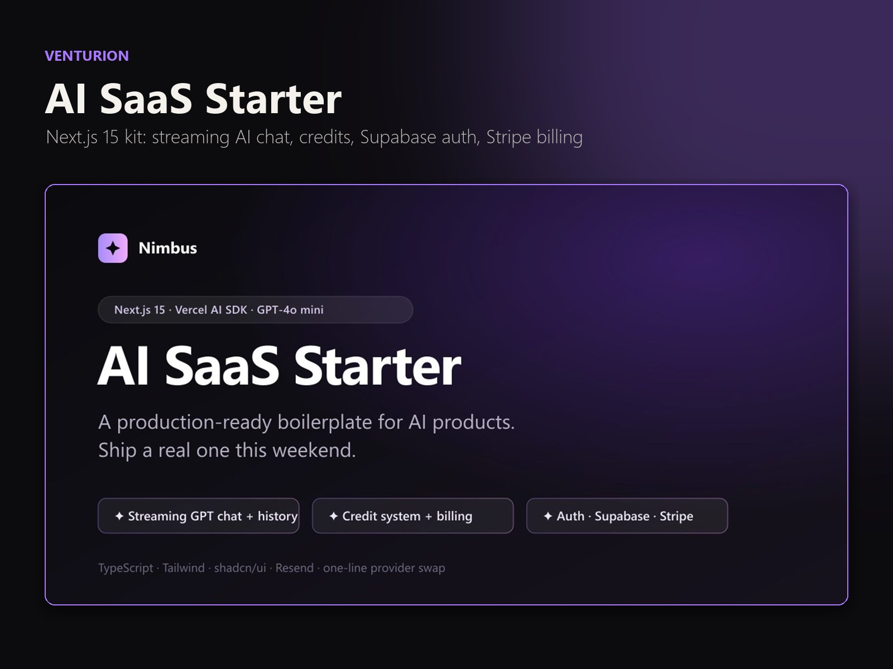

# AI SaaS Starter - ship a real AI product this weekend

A production-ready boilerplate for AI products, sold as a digital product.

## What's inside
- Streaming AI chat with history and a sidebar
- Credit system that can't double-charge when requests overlap
- Supabase auth: email, Google, GitHub
- Stripe Checkout, plans, credit packs, customer portal and webhooks
- Resend emails and database row-level security
- Swap the AI provider in one line

## Built with
Next.js 15, TypeScript, Supabase, Stripe, Resend, Vercel AI SDK, Tailwind, shadcn/ui.

## About this repository
This is a showcase: what the product does, how it is built and what it looks like. The source code is private. Want something like this for your business? Book a 15-minute call: https://cal.com/haroon-younis-p9tjo5/intro - or visit https://venturionai.com

Built by **VENTURION**, an AI agents & automation studio in London.
